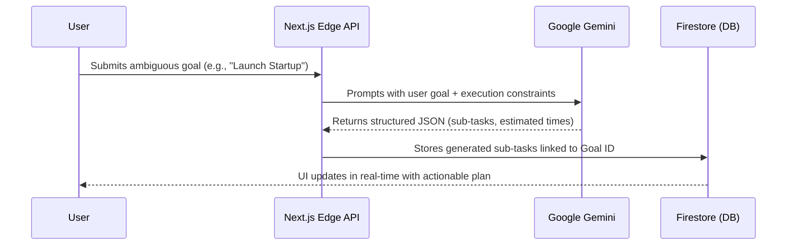
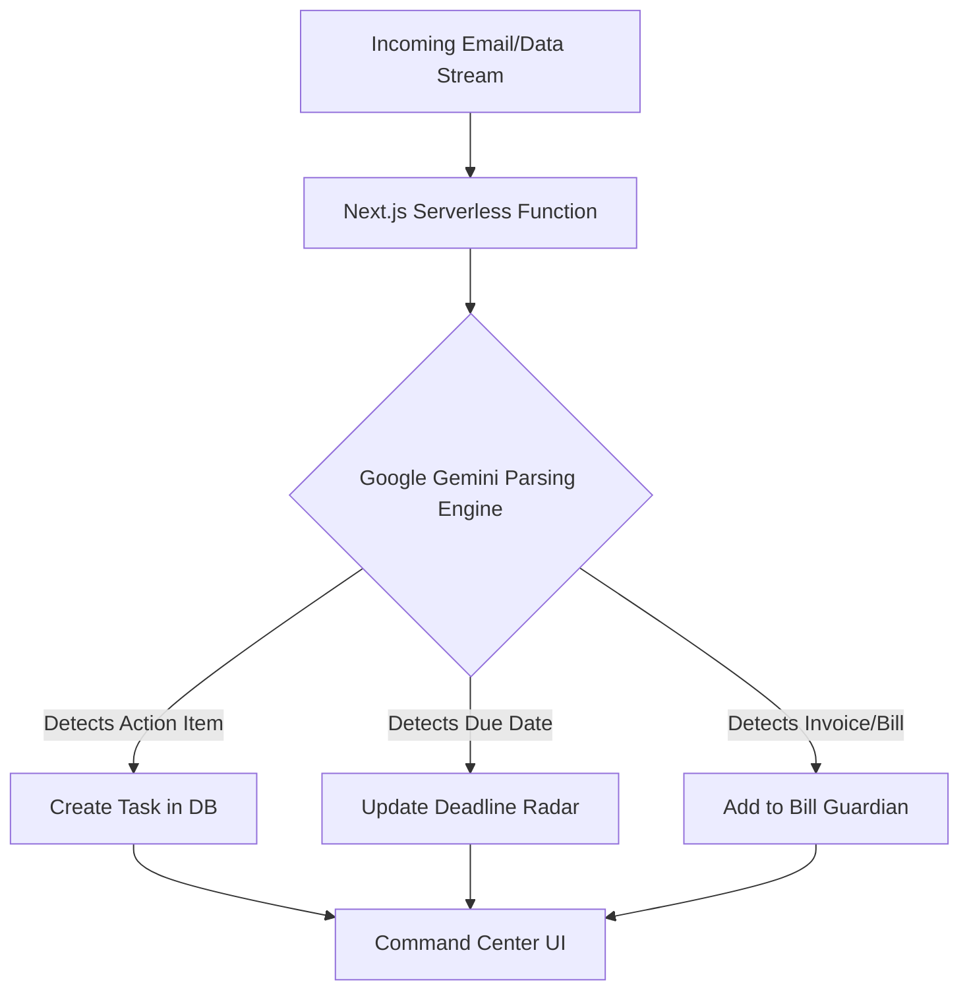

<div align="center">
  <!-- Note: Place your vibe2ship.png logo inside the /public folder of your repo! -->
  
  <br/>
  <br/>
  
  <h1>✨ Planic AI</h1>
  <p><strong>The AI Accountability Operating System</strong></p>
  <p><em>Built for the "Vibe 2 Ship" Hackathon by CodingNinjas & Google for Developers</em></p>

  <div>
    
    
    
    
    <br/>
    
    
    
    
  </div>
</div>

---

## 🚀 The Challenge: The Last-Minute Life Saver
Students, professionals, and entrepreneurs frequently miss deadlines, bill payments, and interviews because existing tools rely on passive reminders that are easy to ignore. The problem isn't a lack of tools, but rather **"tool fatigue"**—data is fragmented across calendars, financial apps, to-do lists, and email clients.

**Planic AI** flips this paradigm entirely. Instead of waiting for users to manually check off tasks, Planic AI proactively connects to disparate data streams (like Gmail) and uses Google's Gemini models to act as a proactive Executive Assistant. It tracks upcoming financial obligations, prioritizes tasks via a dynamic "Accountability Score," and intervenes with "Panic Mode" to aggressively restructure failing schedules before deadlines are missed.

---

## 🔥 Key Features

- **📊 Command Center & Accountability Score:** A central dashboard aggregating all active modules. Users monitor their real-time "Accountability Score"—a dynamic metric that drops when tasks are overdue, employing behavioral psychology to encourage action.
- **🚨 Panic Mode (Intelligent Triage):** When overwhelmed, users activate Panic Mode. The UI locks into a high-contrast, distraction-free brutalist environment. Google Gemini aggressively triages and restructures tasks, forcing focus on the most critical item.
- **🤖 AI Planner (Autonomous Breakdown):** Powered by Google Gemini, the AI Planner ingests massive, ambiguous goals (e.g., "Launch a Startup") and automatically breaks them down into daily, bite-sized, and actionable sub-tasks.
- **📧 Gmail Intelligence:** Planic AI connects directly to your inbox. Using advanced LLMs, it parses incoming emails to automatically extract action items, detect deadlines, and turn static emails into trackable operational tasks.
- **💸 Bill Guardian:** A financial fail-safe. It autonomously scans data streams for upcoming bills and recurring subscriptions, ensuring payment deadlines are never missed.

---

## 🏗️ Architecture & AI Agent Workflows

### 1. The AI Planner (Autonomous Goal Breakdown)
The AI Planner uses Google Gemini to ingest a high-level goal and autonomously generate a structured, chronologically ordered task list.



### 2. Context Extraction (Gmail Intelligence & Bill Guardian)
Instead of passive reminders, background agents actively scan connected streams to find hidden obligations.



---

## 🛠️ Getting Started (Local Development)

To run Planic AI locally, follow these steps:

### 1. Clone the repository
```bash
git clone https://github.com/bitmorphic/futureyouai.git
cd futureyouai
```

### 2. Install dependencies
```bash
npm install
```

### 3. Setup Environment Variables
Create a `.env.local` file in the root directory and add your Firebase, Google Cloud, and NextAuth credentials:

```env
# Firebase Configuration
NEXT_PUBLIC_FIREBASE_API_KEY="your_api_key"
NEXT_PUBLIC_FIREBASE_AUTH_DOMAIN="your_auth_domain"
NEXT_PUBLIC_FIREBASE_PROJECT_ID="your_project_id"
NEXT_PUBLIC_FIREBASE_STORAGE_BUCKET="your_storage_bucket"
NEXT_PUBLIC_FIREBASE_MESSAGING_SENDER_ID="your_sender_id"
NEXT_PUBLIC_FIREBASE_APP_ID="your_app_id"

# Google Auth (for NextAuth)
GOOGLE_CLIENT_ID="your_google_client_id"
GOOGLE_CLIENT_SECRET="your_google_client_secret"

# NextAuth Configuration
NEXTAUTH_URL="http://localhost:3000"
NEXTAUTH_SECRET="your_generated_secret"
```

### 4. Run the development server
```bash
npm run dev
```

Open [http://localhost:3000](http://localhost:3000) with your browser to see the result.

---

## ☁️ Deployment (Google Cloud Run)
This application is fully containerized and designed to be deployed on **Google Cloud Run**.

1. Connect your GitHub repository to Google Cloud Build.
2. Select the `main` branch.
3. Use Google Cloud's automated **Node.js Buildpacks** (no Dockerfile required).
4. Supply your environment variables in the Cloud Run configuration.
5. Deploy and allow unauthenticated invocations to make the app public.

---

*Built with ❤️ for the Vibe 2 Ship Hackathon.*
