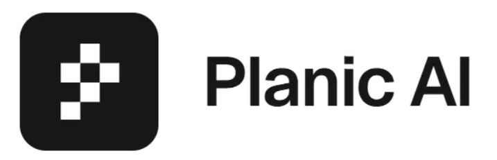
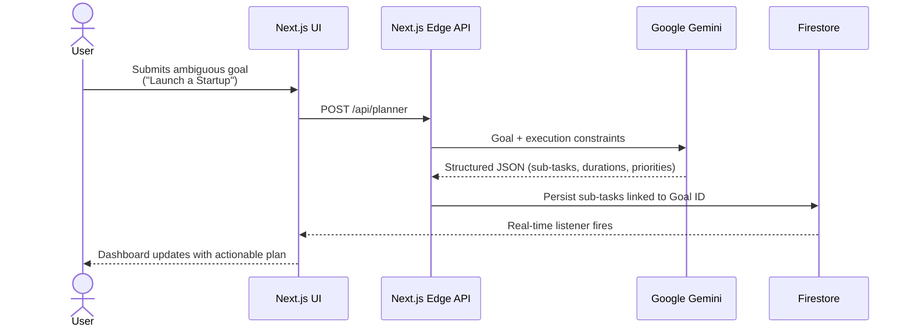
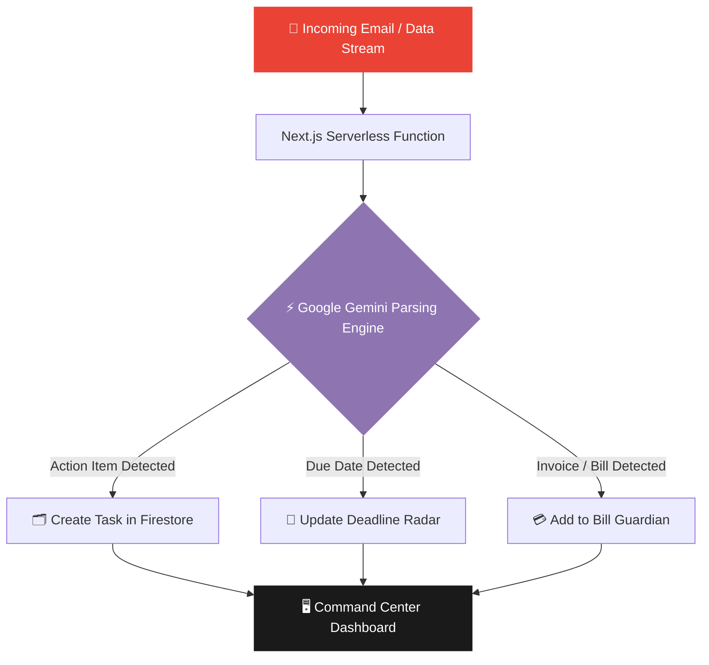
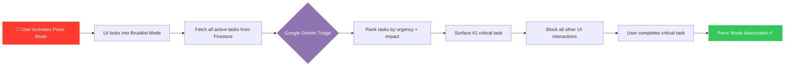
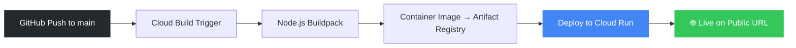

<div align="center">

  

  <h1>Planic AI</h1>
  <p><strong>The AI Accountability Operating System</strong></p>

  <br/>

  

  <br/><br/>

  <!-- Tech Stack Badges -->
  
  
  
  
  
  <br/>
  
  
  
  
  
  

</div>

---

## 🚀 The Problem: Tool Fatigue is Killing Productivity

Students, professionals, and entrepreneurs frequently miss deadlines, bill payments, and interviews — not because they lack tools, but because existing tools create **"tool fatigue."** Data is fragmented across calendars, financial apps, to-do lists, and email clients, and passive reminders are trivially easy to ignore.

**Planic AI** flips this paradigm entirely. Instead of waiting for users to manually log tasks, it proactively connects to real data streams (like Gmail), uses Google Gemini to extract hidden obligations, and intervenes with **Panic Mode** to aggressively restructure failing schedules before deadlines are missed.

---

## 🔥 Core Features

| Feature | Description |
|---|---|
| 📊 **Command Center** | Central dashboard aggregating all active modules with a real-time Accountability Score |
| 🚨 **Panic Mode** | High-contrast brutalist UI locks in. Gemini triages and restructures tasks to surface the single most critical action |
| 🤖 **AI Planner** | Ingests ambiguous goals (e.g., *"Launch a Startup"*) and autonomously breaks them into daily, actionable sub-tasks |
| 📧 **Gmail Intelligence** | Parses incoming emails to extract action items, detect deadlines, and convert static emails into tracked tasks |
| 💸 **Bill Guardian** | Scans connected data streams for upcoming bills and recurring subscriptions so payment deadlines are never missed |

---

## 🏗️ Architecture & AI Agent Workflows

### 1. AI Planner — Autonomous Goal Breakdown

The AI Planner sends a high-level goal to Google Gemini and receives a structured, chronologically ordered task list in return, which is persisted to Firestore and surfaced in real-time on the dashboard.



---

### 2. Gmail Intelligence — Context Extraction Pipeline

A background serverless agent scans the connected inbox, forwards email content through Gemini's parsing engine, and routes extracted intelligence (tasks, deadlines, bills) into the appropriate modules automatically.



---

### 3. Panic Mode — Intelligent Triage Flow

When the user is overwhelmed, Panic Mode locks the UI and invokes Gemini to perform aggressive triage on the current task list.



---

## 🛠️ Local Development

### 1. Clone the repository
```bash
git clone https://github.com/bitmorphic/futureyouai.git
cd futureyouai
```

### 2. Install dependencies
```bash
npm install
```

### 3. Configure environment variables

Create a `.env.local` file in the root directory:

```env
# Firebase
NEXT_PUBLIC_FIREBASE_API_KEY="your_api_key"
NEXT_PUBLIC_FIREBASE_AUTH_DOMAIN="your_auth_domain"
NEXT_PUBLIC_FIREBASE_PROJECT_ID="your_project_id"
NEXT_PUBLIC_FIREBASE_STORAGE_BUCKET="your_storage_bucket"
NEXT_PUBLIC_FIREBASE_MESSAGING_SENDER_ID="your_sender_id"
NEXT_PUBLIC_FIREBASE_APP_ID="your_app_id"

# Google OAuth (NextAuth)
GOOGLE_CLIENT_ID="your_google_client_id"
GOOGLE_CLIENT_SECRET="your_google_client_secret"

# NextAuth
NEXTAUTH_URL="http://localhost:3000"
NEXTAUTH_SECRET="your_generated_secret"
```

### 4. Start the dev server
```bash
npm run dev
```

Visit [http://localhost:3000](http://localhost:3000).

---

## ☁️ Deployment on Google Cloud Run

This app is fully containerized and optimized for **Google Cloud Run** with zero cold-start configuration.

1. Connect your GitHub repo to **Google Cloud Build**
2. Target the `main` branch
3. Use Google's automated **Node.js Buildpacks** — no Dockerfile needed
4. Inject environment variables in the Cloud Run service configuration
5. Enable unauthenticated invocations to make the app publicly accessible



---

## 📁 Project Structure

```
futureyouai/
├── public/
│   ├── planic-ai-logo.png
│   └── vibe2ship.png
├── app/
│   ├── api/                  # Next.js Edge API routes
│   │   ├── planner/          # AI Planner endpoint
│   │   ├── gmail/            # Gmail Intelligence endpoint
│   │   └── bills/            # Bill Guardian endpoint
│   ├── dashboard/            # Command Center UI
│   ├── panic/                # Panic Mode UI
│   └── layout.tsx
├── components/
├── lib/
│   ├── firebase.ts           # Firebase client config
│   └── gemini.ts             # Gemini API wrapper
├── .env.local
└── next.config.js
```
